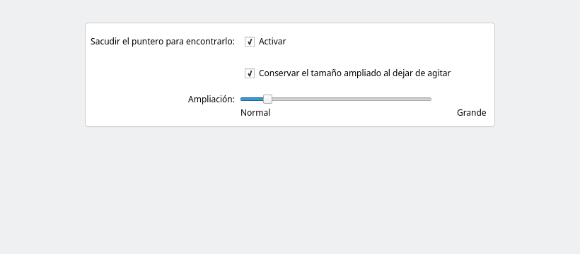

# Plasma Persistent Shake Cursor

Añade una opción a **Preferencias del sistema → Accesibilidad → Sacudir el puntero** para conservar el tamaño que alcanza el cursor al agitarlo.

La casilla **«Conservar el tamaño ampliado al dejar de agitar»** está desactivada por defecto. Al activarla y pulsar **Aplicar**, el cursor mantiene la ampliación alcanzada y puede seguir creciendo al agitarlo. Al desmarcarla y aplicar, vuelve al tamaño normal.

## Compatibilidad

Esta primera versión está preparada y probada para **CachyOS, Plasma 6.8.2 sobre Wayland**, con estos paquetes originales:

| Paquete | Original | Versión local |
|---|---|---|
| `kwin` | `6.8.2-2.1` | `6.8.2-2.1.1` |
| `plasma-desktop` | `6.8.2-1.1` | `6.8.2-1.1.1` |

Los paquetes precompilados son para `x86_64_v3`. El instalador comprueba las versiones antes de continuar. Para otras distribuciones o versiones, usa los parches y recompila contra sus dependencias.

## Instalar

1. Descarga `plasma-persistent-shake-cursor-v1.0.0-cachyos-plasma6.8.2.tar.gz` desde [Releases](https://github.com/jaasieldelgado131/plasma-persistent-shake-cursor/releases/latest).
2. Extrae el archivo y abre una terminal en la carpeta `cursor-persistente`.
3. Ejecuta `bash instalar.sh`, revisa la operación de pacman y confirma.
4. **Cierra sesión y vuelve a entrar** para cargar el KWin modificado.
5. Abre Accesibilidad → Sacudir el puntero, marca la nueva casilla y aplica.

La opción permanece desactivada hasta que la marques. El instalador no reinicia KDE ni cierra la sesión.

## Revertir

Desde la carpeta descargada, ejecuta `bash revertir.sh` y vuelve a iniciar sesión. Se incluyen los paquetes originales y sus firmas para restaurarlos. El script evita bajar de versión automáticamente si KDE ya se actualizó.

Las actualizaciones normales de KDE pueden sobrescribir esta modificación local. No se bloquean paquetes, no se añaden repositorios y no se instala ningún servicio.

## Comportamiento

- Con `KeepSize=false`, se conserva el comportamiento original: el efecto reduce el cursor después de dos segundos.
- Con `KeepSize=true`, se conserva la ampliación hasta desactivar la opción o descargar el efecto.
- La ampliación alcanzada no se guarda entre sesiones.
- Se conserva el renderizado original de KDE: una **flecha superpuesta**. Mientras esté ampliada, esa flecha permanece visible; para recuperar las demás formas del cursor, desmarca la casilla y aplica.

El ajuste se guarda en el grupo `[Effect-shakecursor]`, clave `KeepSize`, de `kwinrc`.

## Código y comprobaciones

- [Parche de KWin y pruebas de integración](patches/kwin-keep-size.patch).
- [Parche del panel de Accesibilidad y traducción española](patches/accesibilidad-keep-size.patch).
- [Compilación y pruebas](docs/BUILD.md).
- [Resultados de verificación](docs/VERIFICATION.md).
- [Licencias y fuentes originales](NOTICE.md).

Los paquetes binarios se distribuyen en Releases, junto con archivos SHA-256 y los árboles de código fuente modificados. Este repositorio contiene los cambios y las herramientas, sin copias de la configuración personal de Linux.
